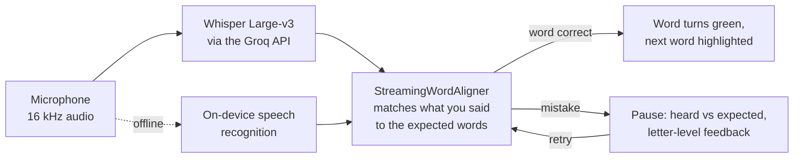

# NEki

A bilingual (English and Bangla) Islamic companion app built with Flutter. Read the Quran,
practise your recitation with a coach that listens in real time and stops on the word you got
wrong, follow prayer times offline, and browse duas and hadith with audio.

<!-- Demo video: on github.com, edit this file and drag your .mp4 onto this line. -->

<!-- Screenshots: add 4–6 phone screenshots to docs/screenshots/ and list them in this table.
| Home | Quran reader | Recitation coach | Prayer times |
|---|---|---|---|
|  |  |  |  |
-->

**Status:** in active development since July 2026. About 33,000 lines of Dart, 160+ automated
tests, and a clean `flutter analyze`.

## What it does

**Recitation coach**
- Recite a single ayah or a whole surah while the app follows you word by word
- When you mispronounce a word, it pauses and shows what it heard next to what was expected,
  with a letter-level breakdown and guidance on where the sound is made
- Retry the word and carry on from the same place, or skip it
- Stops by itself after a short silence at the end of the ayah or surah and shows a scorecard

**Quran**
- All 114 surahs in a continuous Mushaf view or a verse-by-verse study view
- Translation and transliteration in English and Bangla
- Verse-level recitation by Sheikh Mishary Alafasy for all 6,236 verses
- Jump to any ayah, bookmarks, and adjustable Arabic font size and playback speed

**Prayer times**
- Calculated on the device with no internet needed, from GPS or a list of 30+ cities
- 10 calculation methods, Hanafi or Shafi'i Asr, and per-prayer minute adjustments
- Hijri date, Sehri and Iftar times, a daily prayer tracker and a monthly timetable

**Duas, hadith and tasbih**
- 81 duas by occasion with Arabic audio: studio recitation for the 20 Quranic duas and neural
  text-to-speech for the other 61, cached for offline replay
- All 97 books of Sahih al-Bukhari, loaded in Arabic, English and Bangla, with 22 hadiths
  bundled for offline reading
- A tap counter for dhikr with presets and haptic feedback

**Everywhere**
- A home screen whose sky and colours follow the current prayer time
- Light, dark and system themes, and a full switch between English and Bangla
- A mini player that keeps audio going while you move around the app

## How the recitation coach works



Audio is captured in short chunks and sent to Whisper as it arrives. The aligner compares the
growing transcript with the verse, looking a few words ahead so it keeps up with natural
recitation, and carries its position across ayah boundaries in whole-surah mode. The
pronunciation matcher then compares the heard and expected words letter by letter.

## Built with

Flutter · Dart · Riverpod · just_audio · Whisper Large-v3 (Groq) · speech_to_text ·
Edge neural TTS · adhan · geolocator · shared_preferences

Quran audio comes from EveryAyah, the Quran text from the `quran` package, and hadith text
from [hadith-api](https://github.com/fawazahmed0/hadith-api).

## Run it locally

```bash
git clone https://github.com/SaminYeaserKhan/NEki.git
cd NEki
cp .env.example .env   # add a free Groq API key from console.groq.com
flutter pub get
flutter run --dart-define-from-file=.env
```

Without a Groq key, the recitation coach uses on-device speech recognition instead.

## Tests

```bash
flutter test
```

The suite covers the streaming word aligner, pronunciation matching, prayer-time
calculation, the audio player and the main screens.

## Roadmap

- Zakat calculator and distribution guide
- Islamic studies quiz module
- Achievements
- Qibla compass
- An AI assistant for questions about the app's content

The full milestone list is in [`task.md`](task.md).

## License

MIT. See [`LICENSE`](LICENSE).
